# Automation Restaurant

**One connected operating system for a restaurant** — customer ordering, kitchen
tickets, recipes, inventory, suppliers, finance, staff and AI, all on the same
live data.

- Website: https://web-rho-rosy-56.vercel.app
- Each restaurant runs on **its own Supabase project**, created automatically at
  sign-up. One restaurant's data never shares a database with another's.

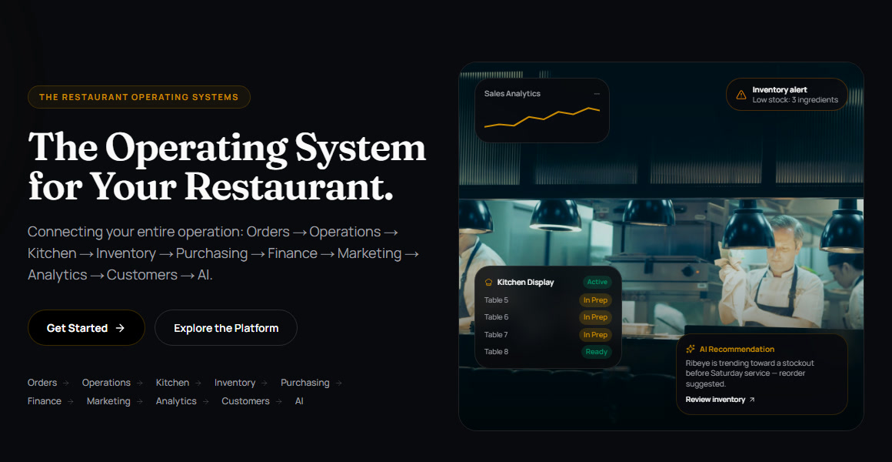

**Contents:** [Problem statement](#problem-statement) ·
[Proposed solution](#proposed-solution) · [Screenshots](#screenshots) ·
[Module navigation](#module-navigation) ·
[Technology stack](#technology-stack) ·
[AI methodology](#ai-methodology-and-implementation) ·
[AI models and APIs](#ai-models-and-api-usage) ·
[Development tools](#development-tools-used) ·
[Setup and installation](#setup-and-installation) ·
[Team member contributions](#team-member-contributions)

---

## Problem statement

New restaurants often face high upfront costs and technical complexity when
they have custom restaurant management software built for billing, orders,
inventory, menus and kitchen operations. Building and maintaining that software
takes developers, time and money that a new restaurant rarely has.

## Proposed solution

Automation Restaurant is an AI-powered, subscription-based Restaurant
Management System (RMS). It lets a restaurant manage billing, orders, menus,
inventory, kitchen operations, suppliers and finances on one central platform.

- **Ready to use:** instead of hiring developers to build custom software, the
  owner signs up and gets working tools straight away.
- **Automated workflows:** an order flows to the kitchen, stock, suppliers and
  finance without anyone re-typing it.
- **AI insights:** an AI assistant answers questions from the restaurant's live
  data, and AI imports turn existing menus and documents into records.
- **Affordable and scalable:** modular features, plan tiers and role-based
  portals let a restaurant start small and grow, including independent branches,
  without the cost of development and ongoing maintenance.

## Why Automation Restaurant

| | Unique selling point | What it means for the owner |
| --- | --- | --- |
| 🔗 | **One live data layer** | An order flows to the kitchen, stock, suppliers, finance and the dashboard at once. Nobody re-types anything. |
| 🧾 | **Recipe-driven stock** | Every sale deducts its recipe's exact grams, millilitres and pieces, so food cost is known per dish as it sells. |
| 🍗 | **Shared-ingredient availability** | When chicken runs low, every dish that uses it is recalculated. Guests only see what the kitchen can actually make. |
| 🤖 | **AI Smart Import** | Upload an existing menu, recipe, inventory or supplier PDF. AI builds a draft, and nothing is saved until the owner approves it. |
| 💬 | **AI on every side** | The owner assistant answers from live data and reads or writes PDFs. Guests get a menu assistant, and visitors get a website AI Guide. |
| 📱 | **QR ordering, no app** | Guests scan the table, order, track it live from kitchen to table, order more and leave feedback. They never sign up. |
| 💰 | **True profit, live** | Every sale, refund, food cost, expense, supplier bill and cash movement is written to one financial ledger as it happens, so P&L, payables and the day close always agree. Exported as a branded PDF or Excel file. |
| 🔁 | **Closed purchasing loop** | Low stock → purchase order → goods received → stock updated → supplier bill due on that supplier's terms. |
| 🛡️ | **Portals built from permissions** | Each staff portal is composed from individual permissions, enforced by the database rather than just hidden buttons. |
| 🏢 | **A database per restaurant** | Every restaurant gets its own Supabase project, provisioned automatically at sign-up. |

## Screenshots

<table>
  <tr>
    <td width="50%">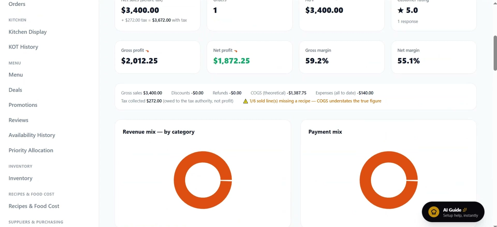<br><b>Owner dashboard</b>: net sales, tax, gross and net profit, margins, revenue and payment mix</td>
    <td width="50%">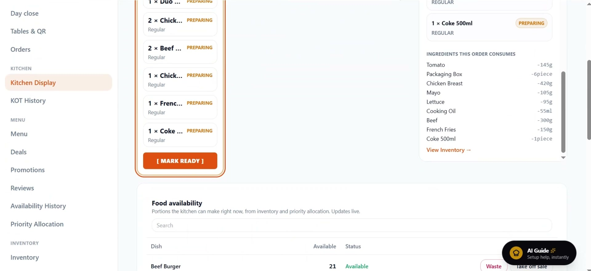<br><b>Kitchen Display</b>: live tickets, the ingredients each order consumes, and portions left</td>
  </tr>
  <tr>
    <td>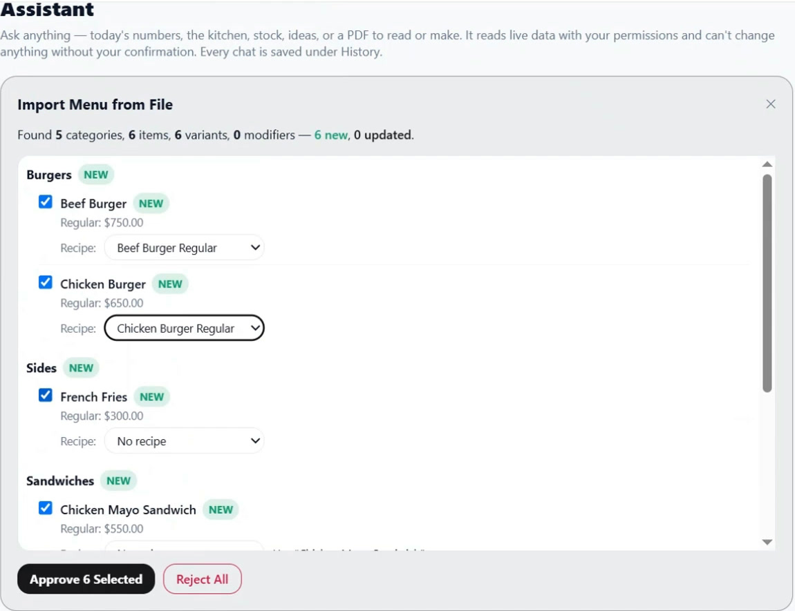<br><b>AI Smart Import</b>: a menu PDF becomes 6 new items in 5 categories, each linked to its recipe, ready to approve</td>
    <td>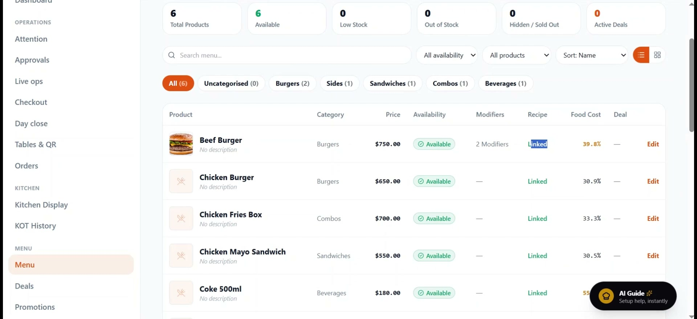<br><b>Menu management</b>: price, availability, linked recipe and food cost % per dish</td>
  </tr>
  <tr>
    <td>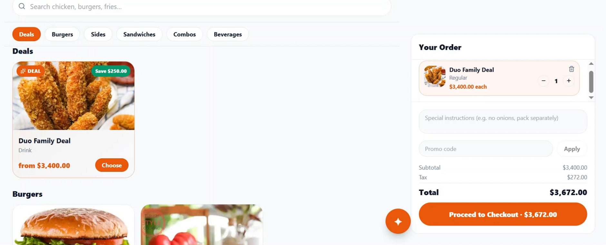<br><b>Customer menu</b>: categories, deals that show the saving, notes, promo codes and tax before checkout</td>
    <td>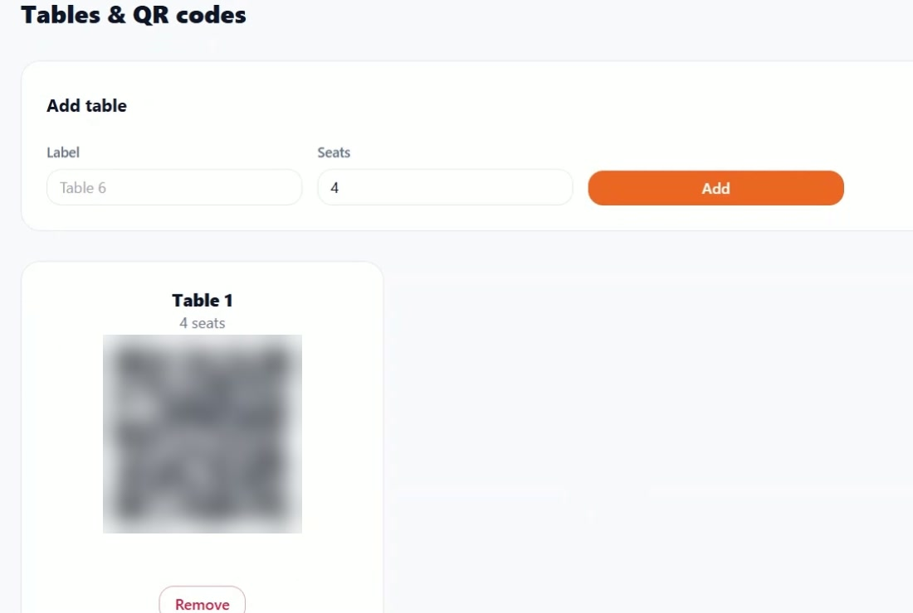<br><b>Tables &amp; QR codes</b>: every table gets its own QR code (blurred here)</td>
  </tr>
  <tr>
    <td>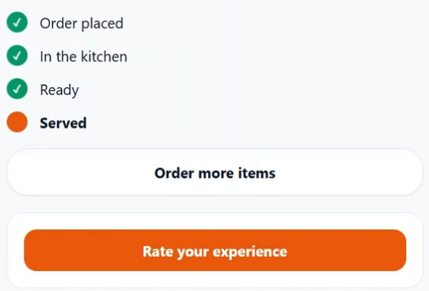<br><b>Order tracking</b>: placed → in the kitchen → ready → served, plus order more</td>
    <td>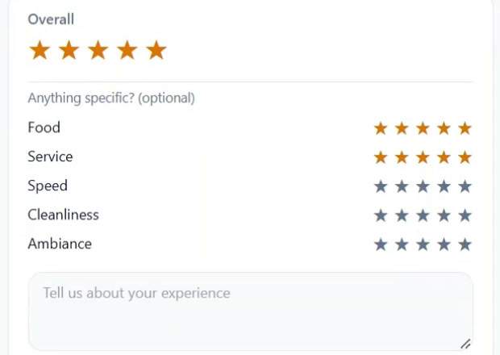<br><b>Guest feedback</b>: overall rating plus food, service, speed, cleanliness and ambiance</td>
  </tr>
  <tr>
    <td>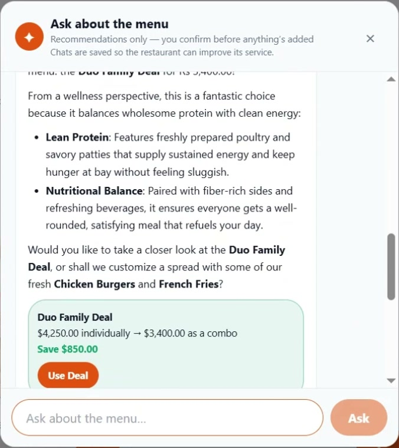<br><b>Customer menu assistant</b>: recommends dishes and calculates real deal savings</td>
    <td>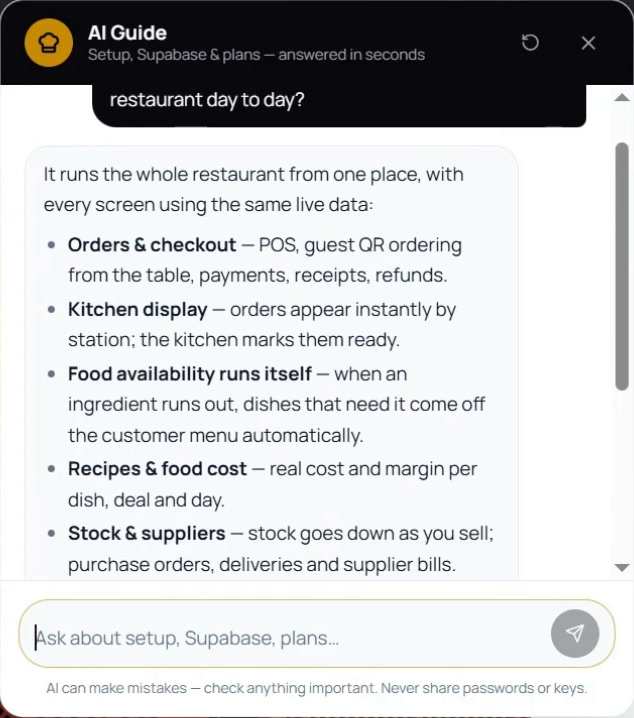<br><b>Website AI Guide</b>: explains the product and walks owners through setup</td>
  </tr>
  <tr>
    <td>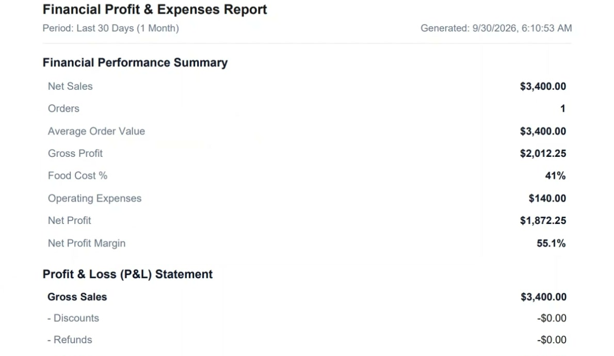<br><b>P&amp;L report</b>: a branded PDF of sales, food cost, expenses and net profit</td>
    <td>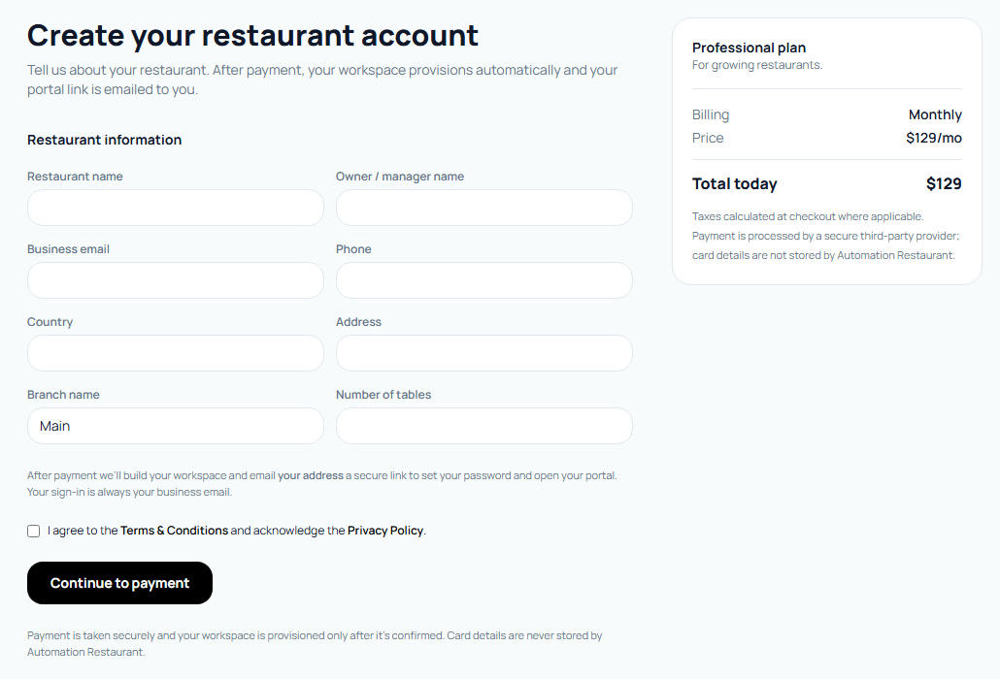<br><b>Sign-up</b>: one form, secure payment, then automatic provisioning</td>
  </tr>
</table>

<sub>Screenshots use a test restaurant with test data.</sub>

---

## Module navigation

The restaurant portal is organised by **module** instead of listing every screen in
the sidebar:

- **Module sidebar:** one entry per module, with an icon. The modules are
  Dashboard, POS & Orders, Kitchen, Menu, Marketing, Inventory, Suppliers, Finance,
  Staff, Analytics, AI Intelligence and Settings. Marketing holds Promotions, Social
  Media and Reviews; Inventory holds Stock, Recipes & Food Cost, Availability History
  and Priority Allocation. A module appears only when the user may
  open at least one of its screens, and it stays highlighted on all of them.
- **Landing pages** (`/r/<slug>/modules/<module>`; Finance at `/r/<slug>/finance`):
  each one has KPI cards and a tile for each of the module's screens.
  - The KPIs use the same queries as the screens they link to, under the user's
    own permissions.
  - A figure that cannot be loaded shows as "Unavailable", never as a made-up
    number.
  - Change badges appear only when there is a real previous period to compare.
- **Sub-navigation bar:** a slim bar above every module screen lists that
  module's screens and underlines the current one. A screen two modules share
  keeps the bar the user arrived with, so Finance → Payables keeps the Finance bar.
- **Breadcrumb:** the top bar shows "Module › Screen" on every page and links back
  to the module's landing page.
- **Phones:** the modules scroll across under the top bar, and the
  sub-navigation scrolls sideways.
- **Permissions:** every tile, KPI and link follows the permission, owner-only
  and plan rules of the screen it opens. The owner panel of a multi-branch
  restaurant keeps its own sidebar.

The modules, their screens and their access rules are defined in one place,
`apps/web/src/lib/modules.ts`, which drives the sidebar, the landing pages and
the sub-navigation.

<table>
  <tr>
    <td width="50%">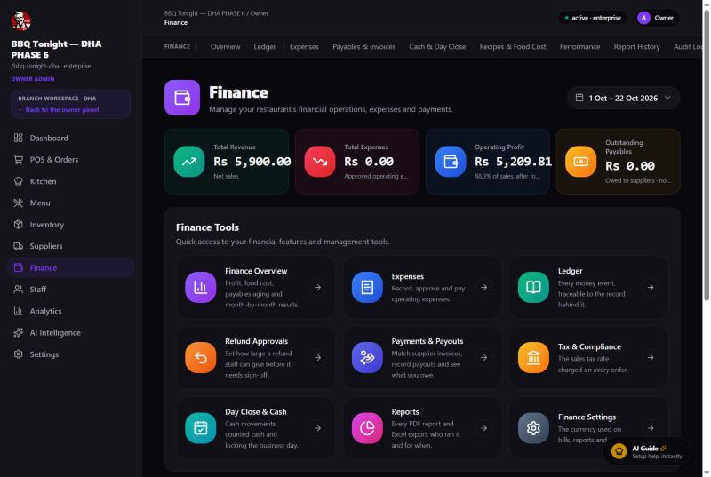<br><b>Finance</b>: date range, revenue, expenses, operating profit and supplier payables, and a tile for each Finance screen</td>
    <td width="50%">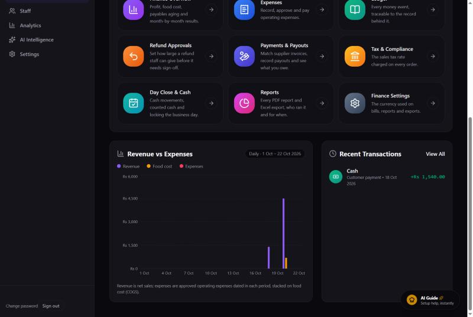<br><b>Revenue vs expenses</b> from the ledger, plus recent payments, expenses and supplier bills</td>
  </tr>
  <tr>
    <td>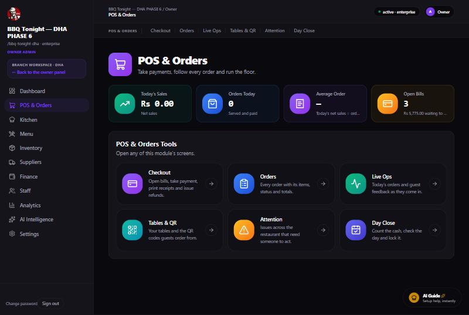<br><b>POS &amp; Orders</b>: today's sales, orders, average order, open bills</td>
    <td>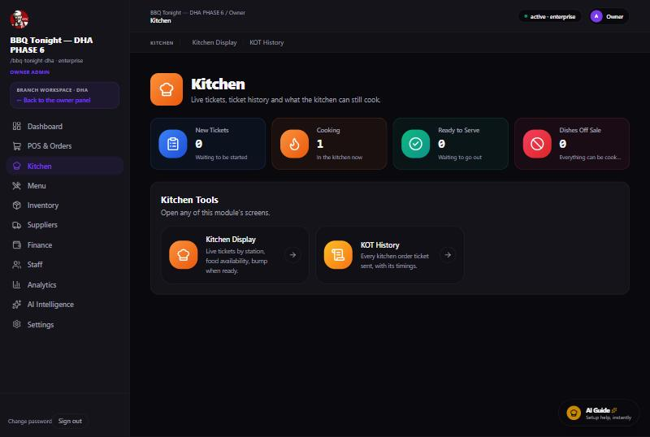<br><b>Kitchen</b>: new, cooking and ready tickets, dishes off sale</td>
  </tr>
  <tr>
    <td>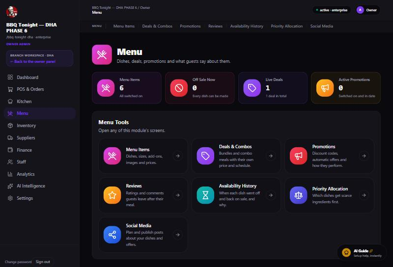<br><b>Menu</b>: dishes, off sale now, live deals, active promotions</td>
    <td>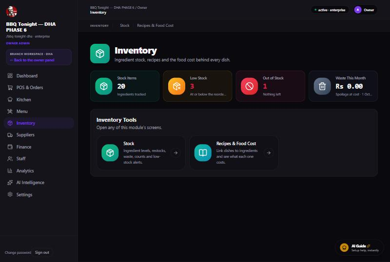<br><b>Inventory</b>: stock items, low and out of stock, waste this month</td>
  </tr>
  <tr>
    <td>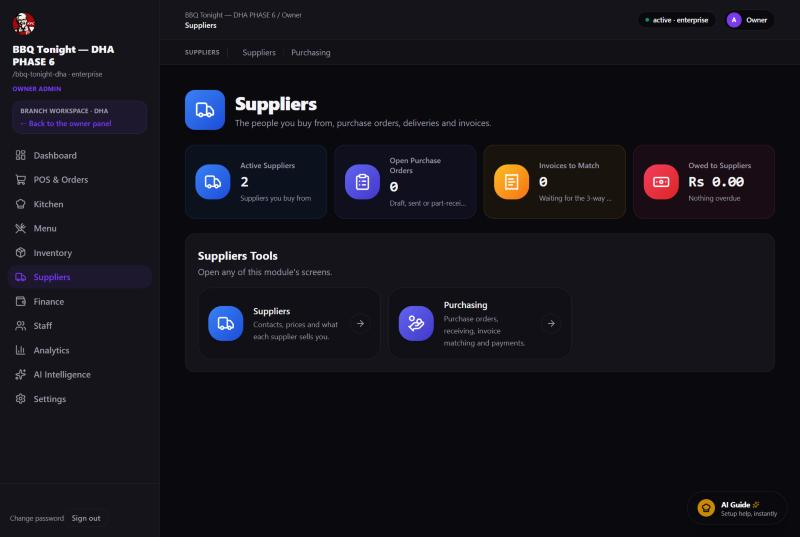<br><b>Suppliers</b>: active suppliers, open purchase orders, invoices to match, money owed</td>
    <td>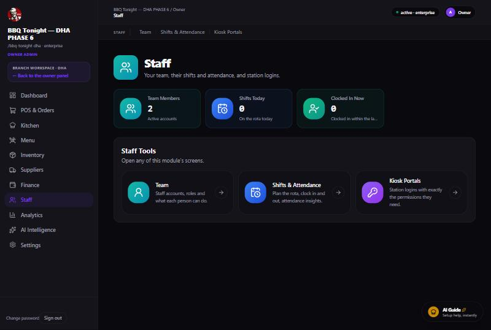<br><b>Staff</b>: team members, shifts today, clocked in now</td>
  </tr>
  <tr>
    <td>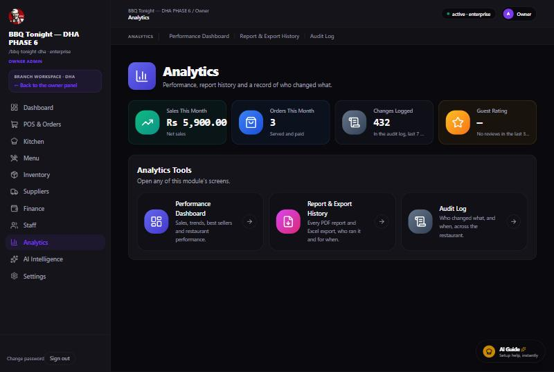<br><b>Analytics</b>: sales and orders this month, audit activity, guest rating</td>
    <td>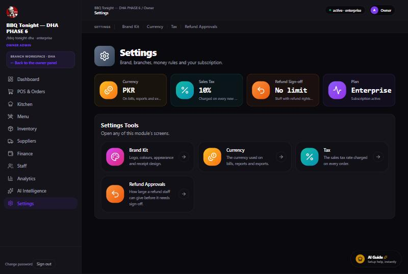<br><b>Settings</b>: currency, sales tax, refund sign-off limit, plan</td>
  </tr>
  <tr>
    <td>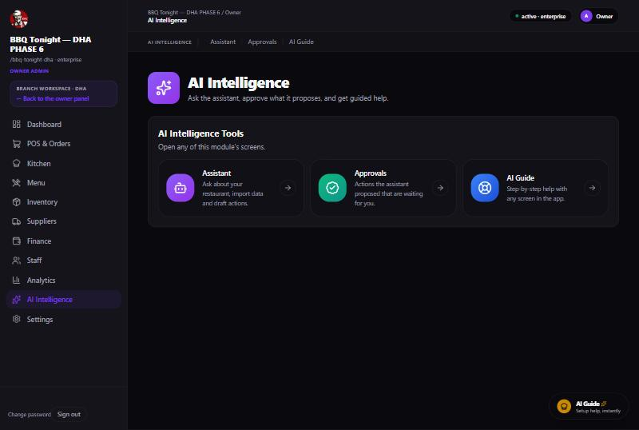<br><b>AI Intelligence</b>: Assistant, Approvals and AI Guide</td>
    <td>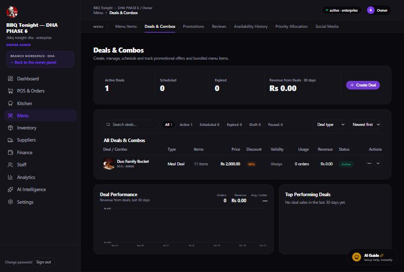<br><b>Sub-navigation</b>: the Menu bar on Deals &amp; Combos, with the breadcrumb Menu › Deals &amp; Combos</td>
  </tr>
  <tr>
    <td>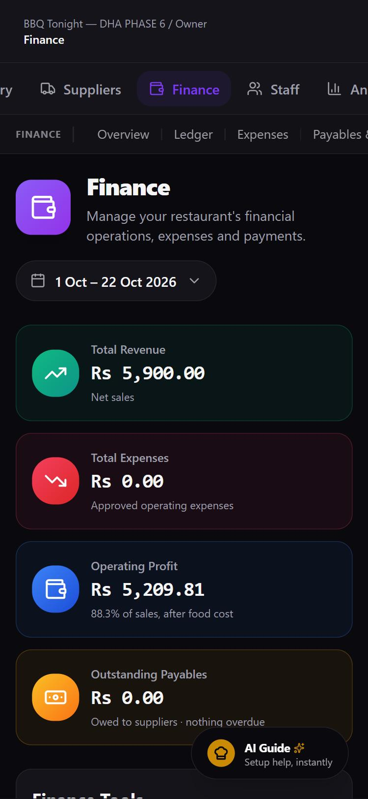<br><b>Phone</b>: module bar, Finance sub-navigation, stacked KPI cards</td>
    <td>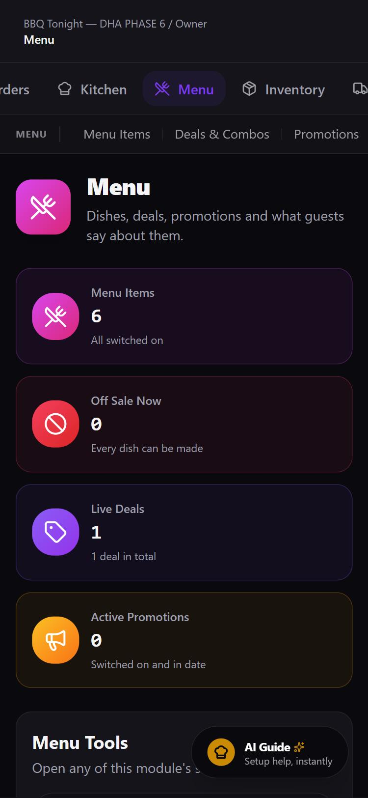<br><b>Phone</b>: the Menu module</td>
  </tr>
</table>

<sub>Captured from a branch workspace (owner login, dark theme). The signed-in
email is hidden. All screens are also in
[docs/module-navigation/Automation-Restaurant-Module-Navigation.pdf](docs/module-navigation/Automation-Restaurant-Module-Navigation.pdf).</sub>

---

## Responsive design

The website, the customer menu and every portal screen work on phones,
tablets, laptops and large desktops.

- **Tested widths:** 320, 375, 430, 768, 1024, 1280 and 1920 px.
- **Routes checked:** 66 routes at every width, with no horizontal scrolling.
  - The website.
  - The customer menu.
  - The owner panel.
  - Every branch screen: POS, Kitchen, Menu, Marketing, Inventory, Suppliers,
    Finance, Staff, AI and Settings.
- **Phones:** the portal sidebar opens as a slide-in drawer from the top bar.
  The drawer includes the workspace switcher, Change password and Sign out.
- **Tables:** wide tables scroll sideways inside their own card.
- **AI Guide:** the AI Guide button shrinks to an icon, so it doesn't cover
  controls such as Checkout's payment button.

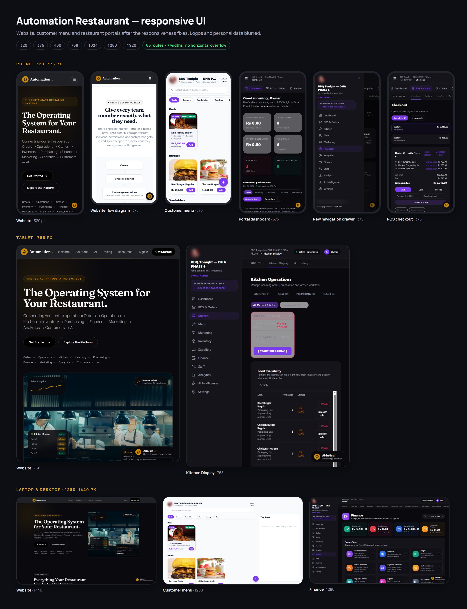

<sub>Phone: website, customer menu, portal dashboard, navigation drawer and
POS checkout. Tablet: website and Kitchen Display. Desktop: website, customer
menu and Finance. Logos and personal data are blurred.</sub>

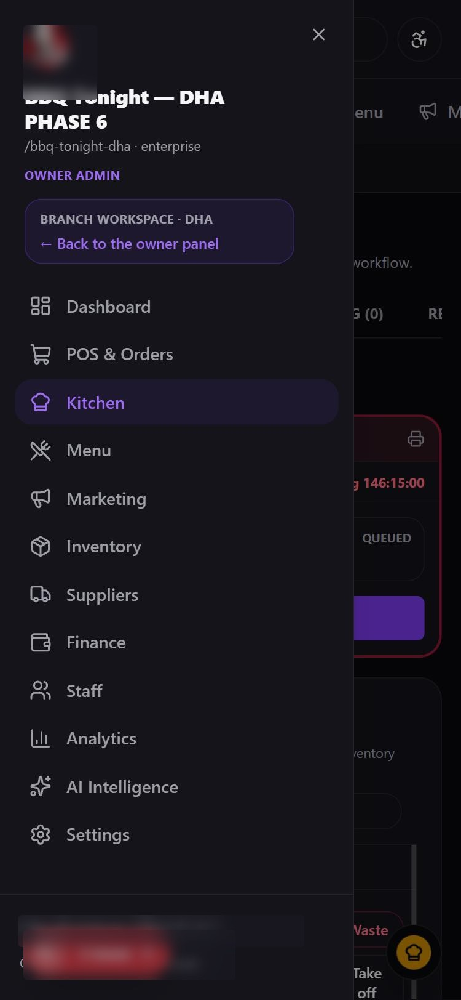

<sub>The navigation drawer on a phone, with the Kitchen Display at full width
behind it. Focus stays inside the drawer and Escape closes it.</sub>

## Languages, voice and accessibility

**Multilingual AI.** The AI Guide, the Assistant and the customer menu's AI
answer in the language you write or speak in: 44 languages are listed, including
English, Urdu (right to left), Roman Urdu, Hindi, Arabic, Punjabi, Sindhi, Pashto,
Persian, Bengali, Tamil, Turkish, French, Spanish, Chinese, Japanese, Korean,
Russian and Indonesian, and the AI also understands languages not on the list.
- The **文A / Auto** button (Language & voice) fixes the answer language. For
  example, ask in Urdu and get the answer in English.
- Figures, prices, currency, dates, dish and supplier names, and screen names
  are kept exactly as they are.
- Each answer bubble carries its own language and direction, so Urdu and Arabic
  read right to left and English inside them stays readable.

**Voice.**
- **Speaking:** tap the microphone and speak in any language. With the listening
  language on **Automatic**, the recording goes to the API, which recognises
  whatever language is spoken (Gemini, `POST /api/ai/transcribe`, staff only and
  rate-limited). With a fixed language, the browser's own recogniser is used
  where it exists.
- **Nothing is sent by voice alone.** The words appear in the message box to
  check before sending. Anything that changes data is still only proposed, with
  Confirm / Cancel.
- **Listening:** **Listen** reads an answer aloud with Pause, Resume, Stop and
  Replay. The device's own voice is used when it has one for the language;
  otherwise (for example Urdu on Windows) the AI voice reads it, in any language
  (Gemini speech, `POST /api/ai/speak`). **AI voice for every language** uses it
  always. The answer is always on screen as text too.

**The AI Guide in the portal** has a **Your restaurant data** tab. It is the
same permission-checked Assistant: for example, ask in Urdu on the Inventory
screen and it reads the real low-stock list. Each module offers its own
suggested questions.

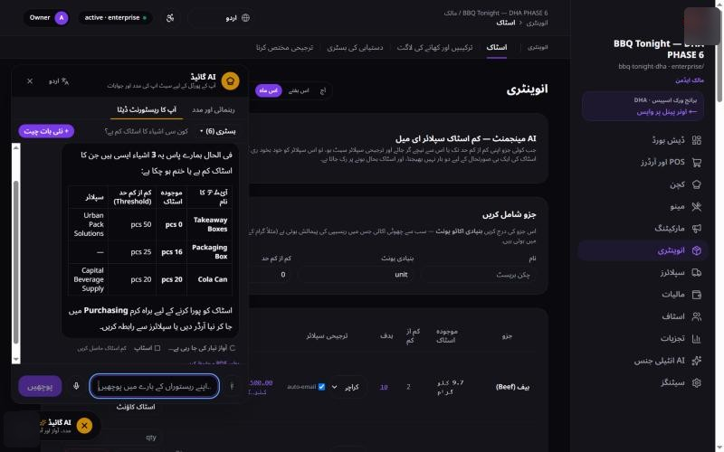

<sub>Inventory: an Urdu question answered in Urdu from the live low-stock list,
read aloud by the AI voice on a computer with no Urdu voice of its own.</sub>

**Settings → AI & Voice** (settings permission) sets, for all modules or for
POS, Kitchen, Menu, Marketing, Inventory, Suppliers, Finance, Staff, Manager,
Admin and Customer:
- the answer and listening languages, and automatic language detection;
- whether voice input and spoken answers are offered.

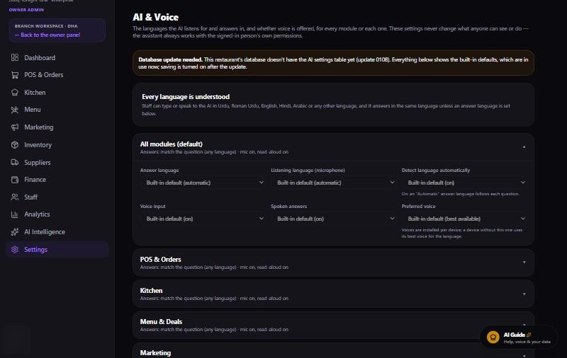

Settings live in the restaurant's own database (`ai_module_settings`, tenant
migration 0108) and are only written by the API, after validation, with an
audit entry. They never widen access: the assistant always works with the
signed-in person's own permissions.

**The portal in Urdu (and any language).** The **🌐 language** button in the portal,
kiosk portal and sign-in headers switches every screen: menus, buttons,
forms, tables and messages. Urdu, Arabic, Persian, Pashto, Sindhi and Hebrew
are laid out right to left.
- Urdu and Hindi ship with dictionaries of about 2,600 screen texts each, so those screens switch instantly and completely.
- Text it doesn't have yet, such as dish names or new messages, and every
  other language are translated by the AI the first time they appear
  (`POST /api/ai/translate-ui`), then cached on the device.
- With the screen in Urdu, the AI answers in Urdu too.

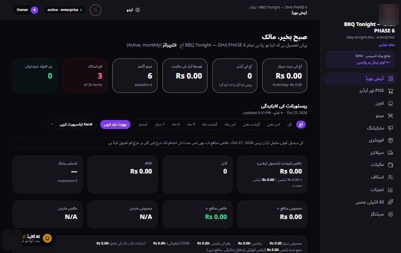

<sub>The manager dashboard in Urdu, laid out right to left: menu, today's
sales, orders, low stock and performance.</sub>

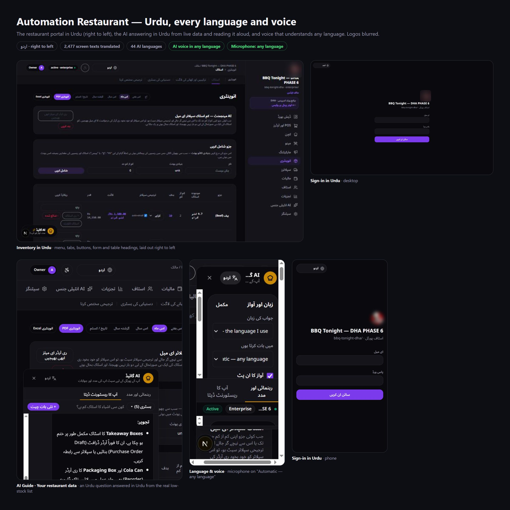

<sub>Inventory and sign-in in Urdu, the AI Guide answering in Urdu from live
stock data, and Language & voice with the microphone on "Automatic — any
language". Logos blurred.</sub>

All screenshots are also in one PDF:
[docs/Automation-Restaurant-Screenshots.pdf](docs/Automation-Restaurant-Screenshots.pdf).
The new features alone (accessibility, Urdu, AI voice, AI & Voice settings and
the phone layout) are in
[docs/Automation-Restaurant-New-Features.pdf](docs/Automation-Restaurant-New-Features.pdf).

**Accessibility.** The ♿ button in every header (website, portals, kiosk
portals, customer menu and admin) offers:
- text size 100–150% (every size is in rem, so layouts reflow);
- high contrast;
- reduce motion (the operating system's setting is always followed too);
- underlined links;
- wider text spacing;
- larger touch targets.

The choice is saved on the device and applied before the first paint on every
page.

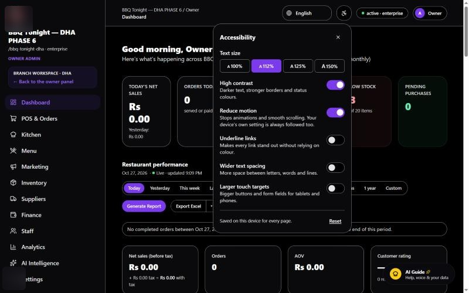

<sub>The ♿ menu on the manager dashboard with high contrast and 112% text.
Amounts wrap after the currency instead of splitting.</sub>

Across the platform:
- Keyboard focus is always visible, and every layout has a "Skip to main
  content" link.
- Dialogs and drawers keep focus inside, close on Escape and return focus.
- AI answers, errors and loading states are announced to screen readers.
- Status is never shown by colour alone.
- Form errors are tied to their fields.
- Wide tables can be scrolled with the keyboard.
- On phones, the Orders list becomes cards.

---

## What it does

| Area | Features |
| --- | --- |
| **Guests** | Table QR codes, no-login ordering (`/order/<slug>?table=…`), search and categories, deals with the saving shown, special instructions, promo codes, tax shown before checkout, live order tracking (placed → in the kitchen → ready → served), order more from the same table, five-part ratings, "Ask about the menu" AI |
| **Kitchen** | Kitchen Display (KOT queue → preparing → ready), the ingredients each ticket consumes, portions left per dish, KOT history |
| **Menu & recipes** | Categories, variants, modifiers, deals, promotions; recipes in base units (g / ml / piece) linked to dishes; per-dish food cost and margin; availability calculated from stock |
| **Inventory** | Stock on hand, low-stock thresholds and email alerts, automatic deduction by recipe on every order, shared-ingredient impact across dishes, [wastage management](#wastage-management) |
| **Purchasing** | Supplier directory with payment terms, purchase requests → purchase orders → goods received → stock update → supplier invoices with a 3-way match (PO ↔ delivery ↔ invoice), typed exceptions, credit notes, and AI reading of invoice PDFs and photos |
| **Finance** | Finance landing page (KPIs, tools, revenue vs expenses, recent transactions) and sub-navigation, finance overview (P&L vs the previous period, food cost % vs target, payables aging, needs-attention list), append-only ledger with corrections, expense approval workflow, supplier payables, cash movements and a locked day close, branded PDF and Excel finance reports — see [Finance model](#finance-model) |
| **Staff & access** | Staff without logins (name, job, shift), custom portals built from individual permissions with a live preview, approvals, audit log, attendance and scheduling |
| **AI** | Owner assistant (live answers from restaurant data, reads and creates PDFs, every chat saved), Smart Import (upload a menu, recipe, inventory, supplier, table, staff or PO document → reviewable draft → approve), customer menu assistant, website AI Guide |
| **Brand** | Brand Kit (logo, colours, receipt style) applied to the menu, receipts, invoices and reports |
| **Branches** | Owner panel for a group of locations: create independent branches (each its own database), a login per branch (password shown once), per-branch receipt details, rename, archive / restore, delete permanently, side-by-side comparison, one-click switching between workspaces — see [Multi-branch](#multi-branch) |
| **Platform** | Marketing site, self-service sign-up and payment, automatic provisioning, plan tiers and upgrades, super-admin console |

## Wastage management

**Inventory → Wastage** (also Kitchen → Record Waste, Finance → Wastage). Tenant migration 0109.

- **Record waste** by ingredient, quantity and unit (base unit, purchase unit, or kg ↔ g / L ↔ ml), reason, date and responsible staff member.
  - Reasons: expired, spoiled, preparation waste, cooking error, overproduction, spillage, other (needs a note).
- **Who approves:**
  - Entries from managers, or anyone with `inventory.manage_waste` / `stock.adjust` / `inventory.manage`, apply at once.
  - Entries from kitchen staff with only `kitchen.record_waste` wait for approval.
  - Approved entries can be reversed with a reason.
- **Stock and cost:**
  - Stock is deducted exactly once, through the existing stock ledger. Each branch's stock row is locked, so stock never goes negative.
  - Cost is fixed at the weighted-average cost at that moment.
  - A repeated submit returns the first entry, keyed by a request id.
  - A reversal puts the stock back once, at the same cost.
- **Finance:** waste posts as `WASTE_RECORDED`; a reversal posts the same amount negative.
- **No double counting:** waste of food an order already used (for example, a dish sent back) is recorded against that order. It is never deducted again, and it is capped at what the order used.
- **Dashboard:** waste cost, waste rate, a trend (daily, weekly or monthly), waste by ingredient and reason, approvals, history and fixed-rule alerts.
- **Expiry:** estimated from a shelf life you set per ingredient, assuming the oldest stock is used first. There is no batch tracking.

**Calculations** (`packages/shared/src/wastage.ts`, from `wastage_report()`):
- Waste cost = quantity wasted × unit cost when recorded, net of reversals.
- Waste rate = waste cost ÷ (recipe usage + waste) at cost.
- Expected closing = opening + receipts + adjustments in − recipe usage − waste − other outflows.
- Variance = actual − expected. Only stock counts create a variance, and it is shown as unexplained, never as waste.

**AI Guide.** `get_wastage_summary` (with an optional `ingredient`) and `get_expiry_risks` answer questions such as "how much did we waste this month?", "why is chicken waste increasing?" or "which ingredients may expire soon?", in any language.
- Every figure comes from the database.
- Suggestions are advice only; the AI never changes stock, purchases or finance on its own.
- There is no forecasting yet; that is future work, once there is enough reliable history.

Tests:
- `npx tsx scripts/test-wastage.ts`, run from `apps/api` (rolled back).
- `npm test -w @automation-restaurant/shared`.

## How a restaurant goes live

| Step | What happens |
| --- | --- |
| 1. Sign up | Pick a plan on the website, fill in one form, pay. The owner connects a free Supabase account and a dedicated database is provisioned automatically, then a set-password email is sent. |
| 2. AI import | Upload existing menu, recipe, inventory and supplier files; review the draft (new / changed / missing prices); approve. |
| 3–6. Check the data | Suppliers, inventory (costs and alert levels), recipes (food cost per dish), menu (each dish linked to its recipe). |
| 7. Portals | Give each job its own portal from individual permissions. |
| 8. Order | Guests scan the table QR code, or the cashier rings the order up. |
| 9. Kitchen | The KOT appears on the Kitchen Display; the guest's tracking page follows it. |
| 10. Stock | Every ingredient in the order's recipes is deducted; availability updates. |
| 11. Purchasing | Low stock alerts the owner and drafts a purchase order to the supplier. |
| 12. Results | Dashboard, reports and the AI assistant all read the same numbers. |

## Technology stack

| Layer | Technologies |
| --- | --- |
| **Frontend** (`apps/web`) | Next.js 15 (App Router), React 19, TypeScript, Tailwind CSS, Lucide icons, Recharts (finance and performance charts), jsPDF + jspdf-autotable (PDF reports), qrcode (table QR codes), Zod (input validation) |
| **Backend** (`apps/api`) | Node.js, Express and TypeScript, deployed as Vercel serverless functions; Zod (request validation), ExcelJS (Excel exports), unpdf (reading supplier invoice PDFs), Nodemailer / Resend (transactional e-mail and supplier messages), Stripe (subscriptions and plan billing) |
| **Database & multi-tenancy** | Supabase PostgreSQL with **a dedicated Supabase project for each restaurant**, so restaurant data is physically separate |
| **Control plane** | A central Supabase project for restaurant registrations, subscriptions, plans and connections to owners' Supabase accounts |
| **Provisioning** | Supabase OAuth and the Management API create each restaurant's database in the owner's own Supabase account, including independent branches |
| **Security** | About 78 Row-Level Security policies and 247 restricted (security-definer) database functions; permissions are enforced in Postgres, not only in the UI |
| **Auth & realtime** | Supabase Auth, with separate session slots so the owner panel, staff portals and branches can stay signed in side by side; Supabase Realtime for live kitchen, order and checkout updates |
| **Schema management** | 107 versioned tenant migrations plus a reusable template schema for every new restaurant |
| **AI** | Google Gemini (Flash and Flash-Lite) as the primary provider; the Anthropic Claude SDK as a second provider — see [AI models and API usage](#ai-models-and-api-usage) |
| **Infrastructure** | Vercel for both apps, redeployed automatically from GitHub; npm workspaces monorepo (`apps/web`, `apps/api`, `packages/shared`) |
| **Testing** | Test scripts run with tsx against real tenant databases inside transactions that are rolled back afterwards |

## AI methodology and implementation

AI in Automation Restaurant is built to deliver practical outcomes across
day-to-day operations, always on the restaurant's own live data and always
under human control.

| AI feature | What it does | Outcome |
| --- | --- | --- |
| **Owner & staff assistant** | Answers questions about sales, profit, food cost, stock, suppliers, kitchen, staff and branches (one branch, or all side by side), and proposes actions (drafting a purchase order, adjusting stock, adding menu items). Knows whether it is in the owner panel or a branch, and who it is talking to | Faster decisions; less time spent digging through reports |
| **AI Guide** | Step-by-step, role-specific help on the website and inside the app, including setting up and managing branches and fixing a failed branch setup | Faster staff onboarding, less training effort, fewer operational errors |
| **AI Import** | Turns prompts or uploaded menu, recipe, inventory, supplier, invoice, purchase-order, staff and table files into structured, validated drafts | Much less manual data entry; faster menu and stock setup |
| **Customer AI** | Helps guests explore the menu, understand ingredients and find relevant deals | A better ordering experience, more conversions and a higher average order value |
| **Billing assistant** | Answers the owner's questions about plans and the subscription, and explains that branches are billed on the main plan while their Supabase projects are Supabase billing | Self-service billing support |

**How it is implemented**

1. **Tools, not guesses.** The assistant reads business data only through
   **71 permission-checked tools** (53 that read figures, 17 that propose
   actions, and one that writes a PDF document). Each tool checks the signed-in
   user's permissions before it runs, so the AI sees only what that person may
   see.
2. **Human confirmation.** An action tool only *proposes* a change. It runs
   after a person taps Confirm. The AI never approves expenses or invoices and
   never makes payments.
3. **Drafts, then approval.** AI Import (`aiDocumentEngine`) extracts text from
   PDFs, images, spreadsheets and text files, asks the model for output that
   must match a fixed schema, validates and cleans the result, compares it with
   live data (new / changed / missing), and shows a draft. Nothing is saved
   until the owner approves it.
4. **Grounded answers.** Figures come from the same ledger and reports as the
   rest of the app; the AI is instructed never to invent numbers.
5. **Knows the platform as it is now.** Each assistant's instructions describe
   the current product, and are updated with every feature:
   - the owner panel, independent branches and their management;
   - branch logins and receipt details;
   - what a branch manager can and can't do.

   A **workspace line** tells the owner assistant where it is (the owner panel
   with its branches, or one branch) and who it is talking to (the owner or the
   branch manager). It can't create, archive or delete branches, set logins or
   change receipt details. It explains where to do that instead, and it never
   states or asks for a password.
6. **One platform.** Combined with POS, kitchen, inventory, recipes, suppliers
   and finance, the AI reduces administrative work, improves stock visibility
   and keeps the customer experience consistent.

## AI models and API usage

Automation Restaurant uses **Google Gemini** as its primary AI provider, with
the **Anthropic Claude API** as a built-in alternative. The server picks the
provider from its configuration (`GEMINI_API_KEY` first, then
`ANTHROPIC_API_KEY`); if neither is set, AI features switch off gracefully. The
live deployment uses Gemini.

| Provider | Models | Used for |
| --- | --- | --- |
| **Google Gemini** | `gemini-3.5-flash-lite`, `gemini-3.1-flash-lite`, `gemini-3.8-flash`, `gemini-3.7-flash`, `gemini-3.5-flash`, `gemini-flash-latest`, `gemini-flash-lite-latest` (default `GEMINI_MODEL`: `gemini-flash-lite-latest`) | Every AI feature (primary) |
| **Anthropic Claude** | `claude-sonnet-5` (configurable with `AI_MODEL`) | Every AI feature (alternative) |

| API | How it is used |
| --- | --- |
| Gemini `streamGenerateContent` (`generativelanguage.googleapis.com/v1beta`) | Streaming chat replies, sent to the browser as server-sent events so answers appear as they are written |
| Gemini `generateContent` | Structured one-shot tasks such as document import and the AI Guide |
| Gemini function calling | Lets the model call the app's permission-checked tools |
| Anthropic Messages API (`@anthropic-ai/sdk`) | The same features with tool use, when Claude is the configured provider |

| Endpoint | Feature |
| --- | --- |
| `/api/ai` | Owner & staff assistant (71 tools; actions confirmed through `/api/ai/confirm`) |
| `/api/public/ai/chat` | Customer AI on the guest menu (read-only, rate-limited per visitor) |
| `/api/public/guide-ai/chat`, `/api/guide-ai/chat` | AI Guide (public and signed-in) |
| `/api/saas-ai/chat` | Billing assistant (owner only) |
| `/api/ai/config` | AI settings per module (languages, voice): effective settings for any staff login; edits for `settings.update` (audited) |
| `/api/ai/transcribe` | Voice input for browsers without speech recognition (Gemini audio → text; staff only, rate-limited, module must allow voice) |
| Import routes (menu, recipe, inventory, supplier, supplier price, supplier invoice, PO, staff, table) | AI document import into reviewable drafts |

**Reliability**
- **Model racing:** if a Gemini model hasn't started answering quickly, or
  fails or is overloaded, the next model starts in parallel; the first to
  answer wins and the others are cancelled.
- **Structured output:** imports force a fixed JSON schema and retry a bounded
  number of times on malformed output.

**Security**
- API keys stay on the server and never reach the browser.
- Uploaded documents are treated as data, never as instructions.
- The restaurant is identified from the authenticated session before any tool
  runs, never from the request body, so one restaurant can never reach
  another's data.
- Customer AI is read-only, limited to the restaurant's public data and
  rate-limited per visitor.

## Development tools used

| Tool | Used for |
| --- | --- |
| **Git & GitHub** | Version control; every push to `main` triggers a deploy |
| **Vercel** | Hosting, preview and production deployments, cron jobs |
| **npm workspaces** | Monorepo for the web app, the API and the shared package |
| **TypeScript compiler (`tsc`)** | Type checking across `packages/shared`, `apps/api` and `apps/web` |
| **tsx** | Running the API in development and the test and migration scripts |
| **Next.js build / dev server** | Local development and production builds of the web app |
| **Supabase** (dashboard, CLI, Management API) | Databases, auth, migrations and automated provisioning |
| **Stripe dashboard** | Plans, prices and webhooks |
| **Google AI Studio** | Gemini API keys and prompt / function-declaration testing (`docs/ai-studio`) |
| **Claude Code** | AI-assisted development, code review and testing |
| **PostCSS & Autoprefixer** | Tailwind CSS build pipeline |

## Finance model

Every finance screen, report and AI answer reads from one place: the
**financial ledger** (`financial_events`). Database triggers write an entry
whenever money moves, so nobody re-types figures and the numbers cannot drift
apart.

```
 orders · payments · refunds ─┐
 expenses (approved / paid) ──┤
 supplier invoices · payments ┼──>  financial_events  ──>  Finance overview · Ledger · P&L
 credit notes · stock · waste ┤     (append-only)          Day close · PDF / Excel · AI
 cash movements · day close ──┘
```

### What the ledger records

| Category | Written when | Effect |
| --- | --- | --- |
| Sales | An order is served or paid; reversed on refund or void | Net sales (subtotal − discount − refunds) |
| Food cost | The same orders, using each line's recipe cost | COGS, the same figure the profit report uses |
| Customer payments | Payment taken, refunded or voided | Money held from customers |
| Expenses | An expense is **approved** (never while still a draft or submitted) | Operating cost on its expense date |
| Supplier payables | An invoice is **approved** (+); supplier payment or credit note (−) | What the restaurant owes |
| Inventory and waste | Goods received, stock adjustments, spoilage, at cost | Stock value |
| Cash, day close, purchasing | Till movements, counts, closes, purchase orders | Information only; no balance change |
| Adjustments | A person with **Adjust ledger** posts a correction with a reason | Fixes a figure; nothing existing is changed |

Ledger rows can't be edited or deleted, even by the database owner. A mistake is
fixed by posting a reasoned correction, which is also written to the audit log.

### The workflows

- **Expenses:** draft → submitted → approved → paid (or rejected / void).
  An expense counts as a cost only once it is approved, and it is counted once
  even after it is paid. Receipts are stored in a private bucket.
- **Supplier invoices:** received → 3-way match against the purchase order and
  the goods received → matched or on hold → approved → partially paid / paid.
  - A hold is typed: total, missing PO, supplier, PO mismatch, missing delivery,
    quantity, price, duplicate or other.
  - A rejected invoice keeps its reason and full history.
  - The AI can read an invoice PDF or photo into a draft, but a person always
    reviews and applies it.
- **Cash and day close:**
  - Pay-ins, pay-outs, bank drops and adjustments each need a reason, and none
    can be edited afterwards.
  - The close preview shows sales, payments by method, expected cash and any
    exceptions.
  - Any difference between counted and expected cash needs a reason.
  - A closed day is locked: no new orders, payments, expenses, counts or
    movements can be dated to it. Refunds are still allowed.
  - Reopening a day needs its own permission and a reason.

### Separation of duties

Each step needs its own permission, so the person who records, approves and
pays can be three different people.

| Step | Permission |
| --- | --- |
| Record or edit an expense | `finance.create_expense` / `finance.update_expense` |
| Approve or reject an expense | `finance.approve_expense` |
| Pay an expense | `finance.pay_expense` |
| Create or match a supplier invoice | `invoices.create` / `invoices.match` |
| Approve or reject a supplier invoice | `invoices.approve` (not `payables.manage`) |
| Pay a supplier | `payables.record_payment` |
| Cash movements | `cash.manage` |
| Close / reopen a day | `finance.close_day` / `finance.reopen_day` |
| Post a ledger correction | `finance.adjust_ledger` |
| See food cost and profit | `finance.view_cogs` / `finance.view_profit` |

The owner holds all of them. Other roles and portals get exactly the ones they
are granted, and each one works the same way in a custom portal. Every check runs in the database: hiding a button is never
the only protection. **The AI never approves or pays anything.**

### Finance screens and reports

- **Finance landing page** (`/r/<slug>/finance`): revenue, expenses,
  operating profit and supplier payables for any date range, compared with the
  previous period. It also has a tile for each Finance screen, a revenue vs
  expenses chart and recent transactions (see [Module navigation](#module-navigation)).
  Every Finance screen has the Finance sub-navigation bar: Overview, Ledger,
  Expenses, Payables & Invoices, Cash & Day Close, Recipes & Food Cost,
  Performance, Report History, Audit Log.
- **Finance overview** (`/r/<slug>/finance/overview`):
  - Net sales, food cost, gross profit, operating expenses, operating profit and
    payments received, compared with the previous period.
  - Food cost % against the restaurant's target (editable; 30% by default).
  - Money owed to suppliers and overdue.
  - A needs-attention list: unclosed days, invoice exceptions, invoices waiting
    for the 3-way match, expenses awaiting approval.
  - Payables aging (not yet due, 1–30, 31–60, 61–90, 90+ days).
  - A food-cost watch of dishes over target or whose recipe cost rose in the
    last 30 days.
- **Ledger** (`/r/<slug>/finance/ledger`): every entry, filterable by period and
  category, with totals and a link back to the screen where its source record
  is managed.
- **Finance report:** a branded PDF (P&L, expenses, supplier payments,
  purchasing) and an Excel workbook (ledger, payables aging, cash & day close,
  accounts payable, supplier payments, expenses), in the restaurant's own time
  zone.

Operating profit = net sales − food cost − approved expenses dated in the
period.

<table>
  <tr>
    <td width="50%">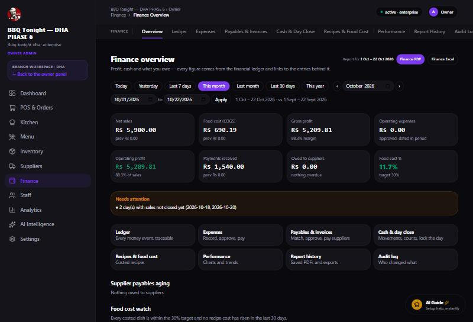<br><b>Finance overview</b>: net sales, food cost, gross and operating profit, payments received, money owed, food cost % against target, what needs attention; the Finance sub-navigation bar sits above it</td>
    <td width="50%">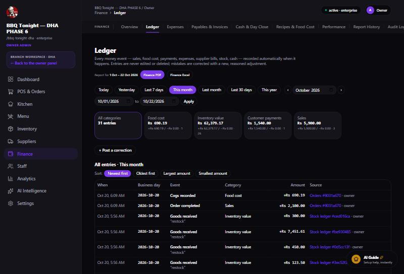<br><b>Ledger</b>: every money event with its business day and a link to its source; totals per category; corrections only, never edits</td>
  </tr>
</table>

## Multi-branch

On the Enterprise plan (`branches.multi`) an owner runs several locations as
**independent restaurants under one owner panel**. A restaurant on a
single-location plan keeps working exactly as before.

### Owner panel and branches

- **The main restaurant is the owner panel.** It shows only what the owner
  needs to run the group:
  - **Overview:** a card per branch;
  - **Branches:** create and manage;
  - **Compare branches**;
  - the **AI assistant** and **AI Guide**;
  - **Billing**;
  - **defaults for new branches:** Brand Kit, currency and tax.

  Orders, kitchen, menu, stock, suppliers, staff and finance all run **inside a
  branch**, including the owner's first shop.
- **Each branch is its own restaurant:**
  - it has its own Supabase project, created in the owner's Supabase account
    through the main restaurant's connection, by the same automated
    provisioning as any new restaurant;
  - it has its own login, menu, recipes, inventory, suppliers, orders, kitchen,
    staff, portals, finance and reports;
  - branch databases are never merged.
- **Creating a branch:**
  - In **Branches → Add a branch**, the owner gives a code (e.g. `DHA`), a name
    (e.g. "DHA Phase 6") and that branch's **receipt details**.
  - Setup takes a few minutes. The branch is never shown as ready before it
    really is, and a failed setup can be retried.
- **One-time copy.** A new branch starts with a copy of these:
  - the menu, recipes and ingredients (stock set to 0);
  - suppliers and deals;
  - branding, tax and currency.

  The copy comes from the owner panel if it has a menu; otherwise it comes from
  the first branch that has one. So a new owner sets the menu up once and later
  branches start from it.

  Orders, stock levels, staff and finance start empty. The copy runs as one
  transaction: all of it, or nothing.
- **Monitoring and comparison:**
  - The **Overview** shows a card per branch: orders, net sales, operating
    profit, low stock, money owed and days not closed.
  - **Compare branches** puts every branch side by side for any period: this
    month, last month, the last 7 or 30 days, or custom dates.
  - The comparison shows orders, net sales, food cost and food cost %, expenses,
    operating profit and margin, average order, low stock, money owed and days
    not closed.
  - It adds an all-branches total and names the most profitable branch.
  - Every figure is read from that branch's own database.
- **Switching workspaces.** The Workspace selector opens any ready branch with a
  one-time sign-in, without logging out of the owner panel. **Back to the owner
  panel** returns to it.

### Managing a branch (Branches → Manage, owner only)

| Option | What it does |
| --- | --- |
| **Branch login** | Sets the branch manager's email (and name). The password is typed or generated (e.g. `Ab3k-9QxP-7mTd`) and **shown once** to copy. **Generate new password** makes a new one. Passwords are never stored readably, so they can't be shown again. Sign-in address: `/r/<branch-slug>/login`. |
| **Receipt details** | That branch's own address, phone, email, website, tax/NTN number and receipt footer, printed on **its** receipts and invoices only. Set while creating the branch, editable here any time. |
| **Edit** | Renames the branch. Its code and address stay the same. |
| **Archive / Restore** | Archive switches the branch off: no sign-ins, no orders, and it leaves the figures. Every record is kept, and it can be restored. |
| **Delete permanently** | Deletes the branch's Supabase project and all its data. The owner types the branch code to confirm. Cannot be undone. |

### What a branch manager can do

| Branch manager | Access |
| --- | --- |
| Orders, checkout, kitchen, tables & QR | ✅ |
| Menu, deals, recipes, inventory | ✅ |
| Suppliers, purchasing, expenses, finance, day close | ✅ |
| Staff, shifts, kiosk portals, AI assistant, AI Guide | ✅ |
| Billing & subscription | ❌ |
| Restaurant settings (currency, tax, branding, receipt details) | ❌ |
| Change password | ❌ — only the owner changes passwords inside a branch |
| Branch creation, branch comparison, other branches | ❌ |

These rules are enforced by the database as well as by the screens:
- The branch manager's login carries no `settings.*` or `branches.*`
  permission, so the branch database refuses any change to its settings or
  receipt details.
- Another branch is a different database, which a branch login can never reach.

### Safeguards
- Only the owner panel's owner can create, retry, manage or open branches.
  Setting logins and permanent deletes also need the owner's own account, not a
  delegated full-access login.
- A branch workspace can't create branches of its own.
- A branch id is only ever looked up among the caller's own branches.
- Creating the same code twice returns the existing branch instead of a second
  project. Two creates racing on one code also end with one branch.
- Branch details are checked before anything is written, so a bad value never
  leaves a half-made branch.
- The plan's branch limit is enforced: branches only count, and the owner panel
  doesn't.
- If Supabase refuses a new project because the owner's organization reached
  the free plan's **2 active projects**, the branch shows that in plain words.
  To fix it, upgrade the organization or pause an unused project, then press
  **Retry**.

### Where it lives

| Piece | Where |
| --- | --- |
| Control-plane columns (`parent_tenant_id`, `branch_code`, copy status) | `supabase/control-plane/0025_branch_tenants.sql` |
| Receipt details held until a new branch is ready (`branch_setup`) | `supabase/control-plane/0026_branch_setup.sql` |
| Create, provision, copy, metrics, logins, receipt details, archive, delete, owner sign-in | `apps/api/src/lib/branchTenants.ts` |
| API (`/api/owner-branches`) | `apps/api/src/routes/ownerBranches.ts` |
| Owner panel overview, switcher, Branches manager, comparison | `apps/web/src/components/OwnerBranches.tsx` |
| Compare branches page | `apps/web/src/app/r/[slug]/(portal)/branches/compare` |
| One-time sign-in page | `apps/web/src/app/r/[slug]/auth/sso` |

| API endpoint | Purpose |
| --- | --- |
| `GET /api/owner-branches` | The branches with their figures for a period |
| `POST /api/owner-branches` | Create a branch (idempotent per code; optional receipt details) |
| `POST /:id/advance`, `POST /:id/retry` | Move setup forward / retry a failed setup or copy |
| `POST /:id/open` | One-time owner sign-in into the branch |
| `GET`/`POST /:id/login` | The branch login (email only) / create or change it, with the password returned once |
| `GET`/`POST /:id/receipt` | The branch's receipt details |
| `PATCH /:id` | Rename |
| `POST /:id/archive`, `POST /:id/restore` | Switch off and back on, keeping all data |
| `POST /:id/delete` | Delete the branch's project and data (`confirm` = its code) |

The earlier in-database branch model (tenant migrations 0098–0106) is retired:
its screens were removed and migration 0107 clears the old per-login branch
limits. Its data stays in the database.

## Architecture

```
                 Control-plane Supabase project
                 (tenants, plans, subscriptions, provisioning, registry)
                               │
  website sign-up ──> apps/api ──> Supabase OAuth / Management API
                               │      create project → apply tenant schema → seed roles + settings
                               │
   restaurant A project    restaurant B project    restaurant C project …
   (own auth users, menu,  (fully isolated —       (RLS on every table,
    orders, stock, chats)   own database)           permission-checked RPCs)
```

- **`apps/web`** resolves `/r/<slug>/…` to that restaurant's project and talks to
  it with the signed-in user's JWT, so Row Level Security applies to every read.
- **`apps/api`** handles anything that needs a secret: provisioning, billing,
  e-mail, AI calls, imports and cron jobs. It resolves the tenant and the user's
  permissions from the JWT on the server and never trusts IDs, roles or
  permissions sent by the browser.
- Service-role keys stay on the server and are never sent to the browser.

## Repository layout

| Path | What it is |
| --- | --- |
| `apps/web` | Next.js 15 (App Router): marketing site, sign-up and onboarding, restaurant portal, custom portals, guest ordering, super-admin |
| `apps/api` | Express API (deployed to Vercel as a serverless function): provisioning, billing, staff, AI assistant and imports, customer AI, AI Guide, cron |
| `packages/shared` | Plan tiers and feature entitlements shared by API and web |
| `supabase/control-plane` | Migrations for the central registry project |
| `supabase/tenant-template/schema.sql` | Full schema applied to every new restaurant |
| `supabase/tenant-migrations` | Numbered migrations rolled out to existing restaurants |
| `docs/ai-studio` | System prompt and function declarations exported for Google AI Studio |
| `docs/module-navigation` | Screenshots and a PDF walkthrough of the module navigation |

## Main routes

| Route | For |
| --- | --- |
| `/`, `/pricing`, `/guide`, `/get-started` | Public website, plans, setup guide, sign-up |
| `/onboarding/…` | Payment confirmation, database connection, provisioning status, set password |
| `/r/<slug>/login` | Staff sign-in for one restaurant |
| `/r/<slug>` | Owner dashboard and every portal page (orders, KDS, menu, recipes, inventory, purchasing, suppliers, finance, staff, AI, settings …) |
| `/r/<slug>/modules/<module>` | A module's landing page: `pos`, `kitchen`, `menu`, `marketing`, `inventory`, `suppliers`, `staff`, `analytics`, `ai`, `settings` |
| `/r/<slug>/finance` | Finance landing page |
| `/r/<slug>/finance/overview`, `/r/<slug>/finance/ledger` | Finance overview and the ledger |
| `/r/<slug>` (multi-branch) | Owner panel overview: a card per branch and this month's comparison |
| `/r/<slug>/branches` | Owner panel: create, manage (login, receipt details, rename, archive, delete) and open branches (Enterprise) |
| `/r/<slug>/branches/compare` | Compare branches side by side for any period |
| `/r/<branch-slug>/login` | A branch's own sign-in (e.g. `/r/bbq-tonight-dha/login`) |
| `/r/<slug>/auth/sso` | One-time sign-in into a branch workspace |
| `/r/<slug>/portal/<portalKey>` | A custom portal, composed from its permissions |
| `/order/<slug>?table=…` | Guest ordering, tracking and feedback |
| `/admin` | Platform super-admin |

## Plans

| Plan | Monthly | Annual (per month) |
| --- | --- | --- |
| Starter | $49 | $39 |
| Professional | $129 | $103 |
| Enterprise | $299 | $239 |

Features are enforced per plan in both the API and the portal (`packages/shared`).

## Setup and installation

**Prerequisites:** Node.js 20+ and npm, Git, a Supabase account (for the
control-plane project and restaurant projects), and optionally a Google Gemini
or Anthropic API key (AI features), a Stripe account (payments) and Resend or
SMTP (e-mail).

1. **Clone and install**

   ```bash
   git clone https://github.com/shiraz-eng/Automation-Restaurant.git
   cd Automation-Restaurant
   npm run setup      # npm install + build packages/shared
   ```

2. **Create the control plane.** Create a Supabase project and run the files in
   `supabase/control-plane/` in order (SQL editor or Supabase CLI). Restaurant
   databases are created automatically later, from
   `supabase/tenant-template/schema.sql`.

3. **Set environment variables** (names only — never commit values):

   - **`apps/api/.env`** — `SUPABASE_URL`, `SUPABASE_SERVICE_ROLE_KEY` (control plane),
     `SUPABASE_ACCESS_TOKEN`, `SUPABASE_ORG_ID`, `SUPABASE_OAUTH_CLIENT_ID`,
     `SUPABASE_OAUTH_CLIENT_SECRET`, `SUPABASE_OAUTH_REDIRECT_URI`, `APP_URL`,
     `ALLOWED_ORIGINS`, `GEMINI_API_KEY` (optional `GEMINI_MODEL`) or
     `ANTHROPIC_API_KEY` (optional `AI_MODEL`), `RESEND_API_KEY` or `SMTP_*`,
     `EMAIL_FROM`, `CRON_SECRET`, `STRIPE_SECRET_KEY`, `STRIPE_WEBHOOK_SECRET`,
     `STRIPE_PRICE_MAP`, `PAYMENTS_MODE`. See `apps/api/src/env.ts` for the full
     list and defaults.
   - **`apps/web/.env.local`** — `NEXT_PUBLIC_CONTROL_PLANE_URL`,
     `NEXT_PUBLIC_CONTROL_PLANE_ANON_KEY`, `NEXT_PUBLIC_API_URL`, `NEXT_PUBLIC_SITE_URL`.

4. **Run locally**

   ```bash
   npm run dev:api    # API on http://localhost:4000
   npm run dev:web    # web on http://localhost:3000
   ```

5. **Check and build**

   ```bash
   npm run typecheck                            # shared + api + web
   npm run build -w @automation-restaurant/web  # production build of the web app
   ```

6. **Create a restaurant.** Open http://localhost:3000, pick a plan and sign up.
   The restaurant's own database is provisioned automatically and a
   set-password e-mail is sent to the owner.

## Database changes

Every tenant schema change is done three ways so new and existing restaurants match:

1. Add `supabase/tenant-migrations/NNNN_name.sql`.
2. Mirror it into `supabase/tenant-template/schema.sql`.
3. Bump `SCHEMA_VERSION` in `apps/api/src/provisioning.ts` (currently **109**).

Roll it out to every live restaurant:

```bash
cd apps/api
npx tsx scripts/apply-tenant-migration.ts ../../supabase/tenant-migrations/NNNN_name.sql
```

Never weaken RLS; new tables get policies in the same migration.

## Deployment

Both apps deploy to Vercel from `main`:

- **web** — root `apps/web`, framework Next.js.
- **automation-restaurant-api** — root `apps/api`, served through `api/index.ts`.

Scheduled jobs (low-stock alerts and similar) call the API's cron routes with
`CRON_SECRET`. See `VERCEL_DEPLOY.md` for the web environment variables.

## Test scripts

`apps/api/scripts/` holds end-to-end checks against real tenant projects, for
example `rbac-test.cjs`, `portals-test.cjs`, `realtime-test.cjs`,
`test-recipe-linking.ts`, `test-availability-engine.ts` and
`test-performance-access.ts`.

The finance suites run against every reachable restaurant in one go. Each
database test is a single transaction that is rolled back, so no real data
changes:

```bash
cd apps/api
bash scripts/run-finance-suite.sh
```

It covers the security hardening, ledger, expense workflow, invoice matching,
day close and finance overview suites, a full fictional restaurant day
(`test-finance-scenario.ts`) and cross-restaurant isolation against the live
API (`test-tenant-isolation.ts`).

Independent branches:
- **`test-owner-branches.ts`**: 68 checks, run in-process against an in-memory
  control plane, so no real project is created. It covers:
  - owner-only access, and isolation between restaurants;
  - idempotent create, including two creates racing on one code;
  - never "created" before provisioning finishes; retry;
  - plan and branch limits, and owner sign-in;
  - branch logins: the password is shown once and never read back; the branch
    manager gets no settings, billing or branch permissions;
  - receipt details set at creation and applied after the copy;
  - rename, archive and restore, and permanent delete with code confirmation.
- **`test-branch-seed.ts`**: rehearses the one-time menu copy inside a
  rolled-back transaction. Any
database suite can rehearse a migration that is not applied yet: set
`PRE_SQL=<file.sql>`. The migration runs inside the same rolled-back transaction.

## Team member contributions

| Member | Role | Contributions |
| --- | --- | --- |
| _Name_ | _Role_ | _What this member built or did_ |
| _Name_ | _Role_ | _What this member built or did_ |

## Known limitations

- AI features use Google Gemini; the free quota can run out (HTTP 429/503). Use a paid key for production.
- Voice depends on the device:
  - Speech recognition uses the browser's own service (Chrome, Edge and Safari
    send the audio to their vendor), or the API's Gemini transcriber.
  - Read-aloud uses the voices installed on the device, and many computers have
    no Urdu or Arabic voice. The answer is always shown as text.
- AI settings per module need tenant migration 0108. Until it is applied, every
  module uses the built-in defaults and the settings page says so.
- Stripe price IDs must be set in `STRIPE_PRICE_MAP` before live card payments work.
- Each branch is a separate Supabase project in the owner's account, so it counts toward
  that account's project limit and cost (the Supabase free plan allows two active projects).
- Inside a branch the Change password button is shown only to the owner, but Supabase always
  lets a signed-in user change their own password through its API; the owner can override it at
  any time with **Generate new password**.
- Portal logins created inside a branch are still asked to set their own password at first sign-in.
